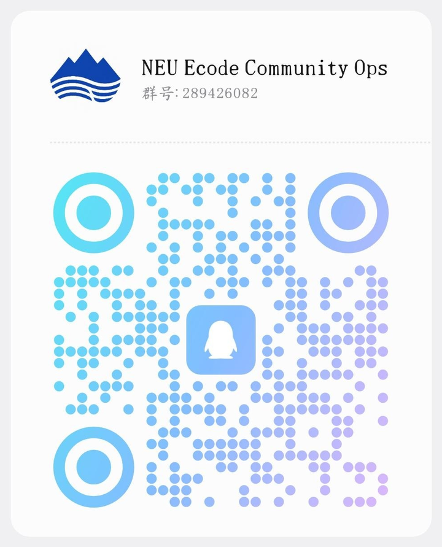

# NEU eCode Android

[Website](https://ecode.exploith.com) · [中文](README.md) · [GitHub](https://github.com/ExploitH/NEU-ECode-Android) · [Gitee mirror](https://gitee.com/exploith/neu-ecode) · [Latest release](https://gitee.com/exploith/neu-ecode/releases) · [License](LICENSE)

**A native companion for campus life at Northeastern University.**  
NEU eCode Android re-stages pay-code, timetable, grades/exams, and campus-intranet access in Kotlin, Jetpack Compose, and Material 3 — a clean, restrained, auditable client for everyday campus work.

Website: [https://ecode.exploith.com](https://ecode.exploith.com)  
Current public release: **7.7** (`versionCode 77`)

> This public repository is a sanitized Android client source release. It does **not** include backend source code, Cloudflare Worker source code, private deployment config, private account data, session cookies, signing keys, private APK download links, raw protocol key material, or raw diagnostic logs.

<p align="center">
  
</p>

<p align="center">
  <em>Mountains for intent. Rivers for the journey.</em>
</p>

---

## Download

- **Website:** [https://ecode.exploith.com](https://ecode.exploith.com)
- Mainland China: [Gitee Releases](https://gitee.com/exploith/neu-ecode/releases)
- GitHub: [ExploitH/NEU-ECode-Android/releases](https://github.com/ExploitH/NEU-ECode-Android/releases)
- Older installs receive an in-app update prompt when opened

Public builds contact the maintainer-operated helper endpoint `https://echelp.exploith.com` for runtime protocol configuration and version metadata. The helper backend is private infrastructure and is not part of this repository.

---

## Community

Please use the QQ group for discussion, feedback, and test builds. Do not post accounts, SMS codes, or packet captures in public issues.

| | |
|---|---|
| Group | `NEU Ecode Community Ops` |
| Number | `289426082` |
| Join | [Scan or tap to join](https://qm.qq.com/q/lunyEDdMOs) |

<p align="center">
  <a href="https://qm.qq.com/q/lunyEDdMOs">
    
  </a>
</p>

<p align="center">
  Scan the QR code with QQ, or search for group number <code>289426082</code>
</p>

Read [SECURITY.md](SECURITY.md) before opening a public issue. Do not attach credentials, cookies, SMS codes, or raw logs.

---

## What it can do now

The bottom bar has only three destinations: **Pay code / Timetable / Me**. Recharge, intranet, the eCode WebView, grades, and exams remain secondary screens.

| Surface | In 7.7 |
|---|---|
| Pay code | Native QR plus balance. The eCode master switch is off by default; when unused, the app neither fetches nor auto-refreshes pay codes. The master switch is separate from “auto-refresh QR”. A CAS SMS challenge turns auto-refresh off and leaves eCode itself enabled. |
| Timetable | Read-only JWXT: a 7×12 grid, term picker, local term settings, album-style week paging. Weeks start on Sunday by default and can switch back to Monday. Cells are computed per week, with one neighbour prefetched on each side. |
| Grades / exams | Secondary pages under Me. Term names are shown in Chinese. The My Exams home widget reads local cache only — no live fetch, no campus ping. |
| Campus intranet | In-app official OpenVPN 3 student tunnel, split so public traffic stays off the tunnel. Idle / Connecting / Connected Lottie states. |
| Home widgets | Pay code, a date-switchable single-day timetable, and My Exams. |
| Me | Long-term login, intranet connection, in-app notices, about/agreement, cache cleanup. |
| Appearance | 7.x unifies the palette, follows system dark mode, and slides the bottom bar in pay → timetable → Me order. |
| Updates | A private helper service publishes version metadata and in-app notices; older installs receive an in-app update prompt. Notices refresh when the app checks for updates. |

NEU eCode is not a substitute for official campus apps. It is an open-source companion for personal study, research, and convenience.

---

## Design

1. **Put the actually-used campus capabilities into native surfaces**, instead of stuffing an entire portal into a WebView.
2. **Give every wait a name.** Sync progress, VPN state, and first-login initialization should tell the user what they are waiting for.
3. **Keep sensitive material on-device and in private infrastructure.** The public tree only publishes an auditable client contract.

Visually, 7.x is unified under the Mountain & River brand: primary blue `#0F45AF`, adaptive launcher artwork, full-screen Lottie loading, and a three-state animation system on the campus intranet page.

Timetable sync is staged from `1/7` campus-network probe through `7/7` timetable assembly. The first-login footnote appears only if `2/7 signing into JWXT` lasts more than four seconds.

---

## Runtime Configuration

Public builds contact:

```text
https://echelp.exploith.com
```

The client uses `ECHELP_BASE_URL` to fetch runtime protocol configuration and app-update metadata. Cloudflare Worker code, deployment files, object-storage config, private APK links, raw protocol key material, and other private infrastructure details are intentionally excluded from the public tree.

Fetched protocol config is cached in Android Keystore-backed encrypted preferences so short helper-service outages do not immediately break installed clients.

---

## Project Structure

```text
app/
├── data/
│   ├── local/          # DataStore, encrypted credentials/config, cookie persistence
│   ├── remote/         # Retrofit APIs, protocol config, update checks, crypto helpers
│   ├── repository/     # Auth / eCode / timetable / personal-data repositories
│   └── vpn/            # In-app OpenVPN 3 service and controller
├── di/                 # Hilt modules
├── domain/             # Models, timetable presentation, VPN artwork mapping
├── ui/                 # Compose screens, navigation, theme, Lottie, WebView
├── widget/             # Home-screen widgets
└── worker/             # WorkManager jobs
```

Protocol notes:

- Read-only pay-code protocol: [docs/ECODE_PAYCODE_PROTOCOL.md](docs/ECODE_PAYCODE_PROTOCOL.md)
- Read-only JWXT timetable: [docs/JWXT_READONLY_SCHEDULE.md](docs/JWXT_READONLY_SCHEDULE.md)
- In-app OpenVPN 3: [docs/OPENVPN3.md](docs/OPENVPN3.md)
- Client update flow: [docs/CLIENT_UPDATE_FLOW.md](docs/CLIENT_UPDATE_FLOW.md)

---

## Build

Prerequisites:

- JDK 17
- Android SDK with API 35
- Gradle wrapper from this repository
- `minSdk` 23; the in-app OpenVPN native core is cross-compiled against API 24, so the tunnel loads on Android 7.0+

Build a debug APK:

```bash
./gradlew :app:assembleDebug
```

Run local unit tests:

```bash
./gradlew :app:testDebugUnitTest
```

Override the helper endpoint for local testing:

```bash
export ECHELP_BASE_URL="https://your-helper.example.com"
./gradlew :app:assembleDebug
```

On a memory-tight headless builder, keep Gradle serial and capped:

```bash
./gradlew --no-daemon --max-workers=2 \
  -Dorg.gradle.jvmargs='-Xmx1408m -XX:MaxMetaspaceSize=512m -Dfile.encoding=UTF-8' \
  :app:testDebugUnitTest :app:assembleDebug
```

---

## Update Flow

The public client expects a private helper service to provide:

1. runtime protocol configuration
2. latest-version metadata
3. a verification-gated APK download link

See [docs/CLIENT_UPDATE_FLOW.md](docs/CLIENT_UPDATE_FLOW.md) for the Android-side flow only. The private Worker/backend implementation, KV data, R2 config, Turnstile secrets, and protocol material are intentionally not published in this repository.

---

## Security and Privacy

- Long-term login credentials are stored only when the user opts in.
- Credentials and cached protocol config prefer Android Keystore-backed `EncryptedSharedPreferences`.
- Network logging is metadata-oriented and redacts sensitive headers/bodies where possible.
- App update checks and gated APK downloads are documented from the Android-client side only.
- Student VPN profiles, CA material, tls-auth, `.ovpn` files, and prebuilt `.so` libraries stay out of public git.
- Do **not** commit backend code, Worker code, deployment config, object-storage config, account credentials, session cookies, APK signing keys, raw diagnostic logs, APK/AAB artifacts, or private download links.

---

## User Agreement and Disclaimer

The app requires the user to read and accept an in-app agreement and disclaimer before login. The key boundaries are:

- This app is not an official app of Northeastern University or related campus service providers.
- Users must only use their own accounts and are responsible for account, device, and network security.
- The maintainer does not redistribute RSA keys, private keys, session tickets, cookies, raw packet captures, or other sensitive reverse-engineering material in this public repository.
- Any user-side packet capture, reverse engineering, extraction, redistribution, or request replay is the user's own responsibility.

---

## Status

This repository is a cleaned open-source snapshot of an actively developed personal campus utility app. Campus endpoints, pages, and policies may change at any time and should be tested only in authorized and compliant contexts.

Current release line (newest first):

| Version | versionCode | Notes |
|---|---|---|
| **7.7** | **77** | In-app developer notices; fix CAS graphic captcha false “wrong code”; exam widget splits date/time/place; notice dots no longer clip |
| 7.6 | 76 | Redesign main screens with a unified palette and system dark mode; restage pay-code, timetable, and Me; slide the bottom bar by tab order; fix the false unknown-error after logout |
| 7.5 | 75 | Add grades/exams lookup and a My Exams home widget; Chinese term names; exams do not auto-refresh |
| 7.4.1 | 74 | Sunday-first weeks now open on today's display week instead of stalling on week 1 |
| 7.4 | 73 | Restore eCode / pay-code; add a master switch; improve fetch and balance refresh |
| 7.3 | 72 | Temporarily pause pay-code / eCode; keep timetable and campus VPN |
| 7.2.1 | 71 | Week grid now starts on Sunday by default and shows short calendar dates; 课表设定 can switch back to Monday |
| 7.2 | 70 | Polished home-screen widgets; the weekly timetable widget is now a date-switchable single-day timetable |
| 7.1 | 69 | Faster course-widget refresh and remaining-today classes |
| 7.0 | 68 | First-sync 403 fix, named sync progress, VPN Lottie triad, Mountain & River branding, per-week paging |
| 6.0 | 67 | In-app OpenVPN 3, protocol pay-code, Sleepy-style timetable |

Product website: [https://ecode.exploith.com](https://ecode.exploith.com). Mainland access should prefer the [Gitee mirror](https://gitee.com/exploith/neu-ecode). GitHub remains the primary repository: `ExploitH/NEU-ECode-Android`.

---

## License

GNU General Public License v3.0. See [LICENSE](LICENSE).

This repository is distributed as a whole under GPL-3.0. Third-party components keep their own licenses:

- OpenVPN 3 core: upstream dual license AGPL-3.0-only OR MPL-2.0; this client elects **MPL-2.0** (see `third_party/openvpn3/NOTICE`)
- Gradle Wrapper: Apache-2.0
- ZXing `com.google.zxing:core`: Apache-2.0
- Lottie Compose `com.airbnb.android:lottie-compose`: Apache-2.0
- Week grid / week chip adapted from [Sleepy](https://github.com/lingion/sleepy) (GPL-3.0, see `third_party/sleepy/NOTICE`)
